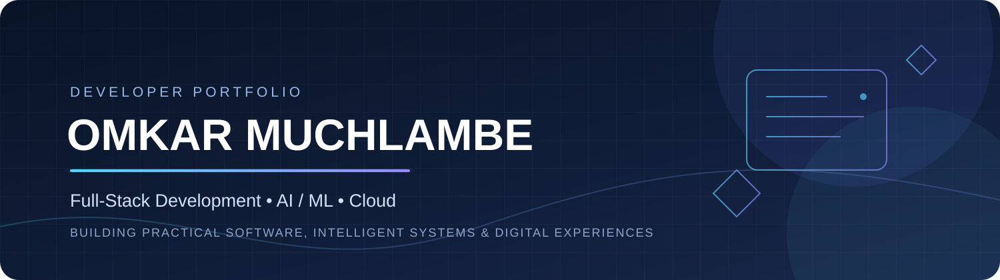

# Hi, I'm Omkar Muchlambe 👋

### B.Tech Computer Science & Engineering · SRM IST · Class of 2027

**Full-Stack Developer | AI/ML Enthusiast | Software Engineer**

I build practical software, full-stack applications and AI-powered systems using Java, Python, JavaScript and SQL.

  
  
  

📍 Chennai, India &nbsp; · &nbsp; 📧 **ommuchlambe123@gmail.com**

---

## 👨‍💻 About Me

I'm a Computer Science Engineering student at **SRM Institute of Science and Technology (SRM IST), Kattankulathur**. I enjoy turning technical ideas into usable applications, exploring AI-driven solutions and understanding how software systems work end to end.

- 🎓 B.Tech CSE, graduating in **2027** · CGPA: **8.28/10**
- 💡 Interested in **Full-Stack Development, Generative AI, RAG, Machine Learning and Cloud Computing**
- 🧩 Comfortable with object-oriented programming, databases, REST API integration and software development fundamentals
- 🌱 Currently strengthening my skills in scalable application development and intelligent software systems

---

## 🧰 Tech Stack

### Languages

  
  
  
  
  
  

### Frameworks, Libraries & AI/ML

  
  
  
  
  
  
  
  

### Databases, Cloud & Tools

  
  
  
  
  
  

| Area | Skills |
|---|---|
| Programming | Python, Java, C, C++, JavaScript, SQL |
| Development | Spring Boot, React, Flask, JDBC, REST APIs |
| AI & Data | Machine Learning, TensorFlow, Scikit-learn, NumPy, Pandas, RAG |
| Databases & Cloud | MySQL, AWS |
| Fundamentals | OOP, DBMS, DSA, Cloud Computing, Software Engineering |

---

## 💼 Experience

### AI/ML Intern (Developer) · InAmigos Foundation
*July 2026 – August 2026 · Remote* · [View Certificate](https://drive.google.com/file/d/1u-ZEXrLO8lH_tFFpEvtkoAObaAYnVrbO/view?usp=drive_link)

- Designed and evaluated structured prompts for LLM-based workflows across education, HR, career guidance, event planning and project-management use cases.
- Tested role-based prompting and contextual instructions to improve response relevance, consistency, tone and task adherence.
- Developed reusable prompt workflows for practical Generative AI applications.

---

## 🚀 Featured Projects

### 🧠 [Codebase RAG Assistant](https://github.com/saberathena25/Codebase-RAG-Assistant)
`Python` `LangChain` `FAISS` `Hugging Face` `Gemini` `GitHub API`

- Developed a Retrieval-Augmented Generation system that lets users ask natural-language questions about software repositories.
- Implemented code parsing, embedding generation and FAISS-based semantic retrieval, then integrated Gemini to produce repository-grounded explanations.

### 📈 [RecallIQ – Customer Re-Engagement Agent](https://github.com/saberathena25/RecallIQ---CRM-Agent-)
`JavaScript` `REST APIs` `CRM`

- Developed the frontend experience for a CRM concept focused on identifying inactive customers and supporting personalized re-engagement.
- Designed customer-focused views and campaign workflows for a more structured win-back process.

### 🎓 [University Management System](https://github.com/saberathena25/University-Management-System-Using-JAVA)
`Java` `JDBC` `MySQL` `HTML` `CSS` `Bootstrap`

- Built a university management application for organizing student, course, faculty, attendance and result information.
- Implemented authentication and CRUD functionality with Java–MySQL database connectivity.

### 🌿 [Leaf Sense](https://github.com/saberathena25/Leaf_Sense)
`Python` `TensorFlow` `MobileNetV2` `Flask` `Pandas`

- Built a deep-learning web application for classifying **38 plant disease categories** using the PlantVillage dataset and MobileNetV2.
- Integrated image-based prediction and disease information into a Flask application.

---

## 📊 GitHub Analytics

  

  

## 🎓 Education

| Institution | Qualification | Year | Result |
|---|---|---:|---:|
| **SRM IST, Kattankulathur** | B.Tech, Computer Science and Engineering | 2027 | CGPA 8.28/10 |
| Vidhya Vardhani Mahavidhalaya, Dapka, Nanded | Class XII – PCMB | 2022 | 86.17% |
| Jai Hind Public School, Udgir, Latur | Class X – CBSE | 2020 | 90.2% |

---

## 🏅 Certifications

- **Alteryx Designer Core** · [View Certificate](https://drive.google.com/file/d/1wx336buUoaEqPTg8FHmLrsKz6avtXCPZ/view?usp=drive_link)
- **Salesforce Agentforce Specialist** · December 2025 · [View Certificate](https://drive.google.com/file/d/1EPpAb2f6Mh9nf8diLNTsvIgpxr1blZ26/view?usp=drive_link)

---

## 🌐 Languages

English · Hindi · Kannada · Japanese

---

## 🤝 Let's Connect

  
  
  

*Thanks for visiting my profile. Feel free to explore my repositories! ⭐*

